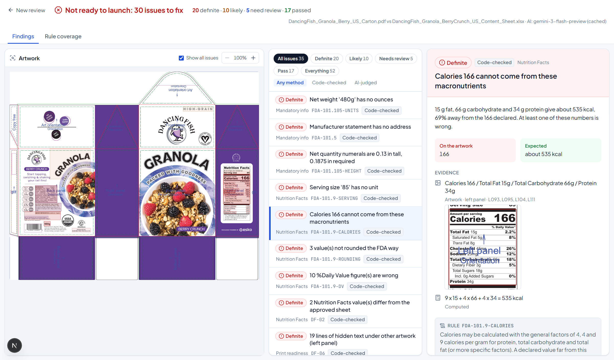
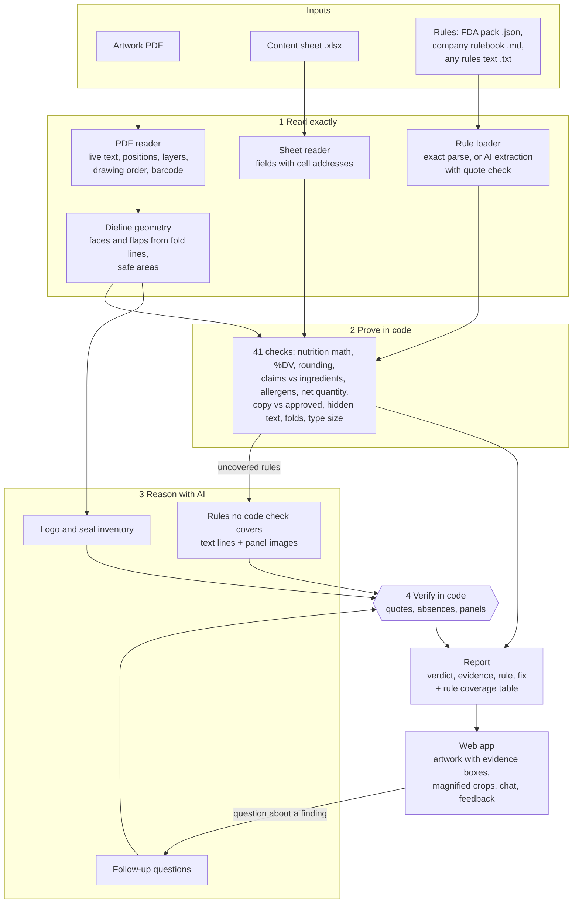

# ShelfReady

**Is this packaging artwork ready to launch?** ShelfReady reviews a packaging artwork PDF against regulations,
a company rulebook and the approved content sheet. It says what is correct, what is wrong and what needs a
person, and shows the evidence behind every finding.

Built for **Esko AIForge 2026**, problem statement 2: *Is this Packaging Artwork ready to launch?*



## The problem, and our approach

Before a carton goes to print, someone has to compare the artwork with the approved product information and
with the rules for its market. The rules live in two places (regulation such as 21 CFR 101, and the company's
own interpretation), the approved data lives in a spreadsheet, and the artwork is a dieline PDF with dozens of
small text blocks across six panels and their flaps. Checking it by eye is slow and errors slip through.

A reviewer needs three things from a tool: findings they can trust, evidence they can verify in seconds, and an
honest line between "this is wrong" and "please look at this". So ShelfReady is built around one principle:

> **Code proves, AI reasons, and code checks the AI.**

1. **Read the artwork exactly.** Packaging PDFs keep their text live. We read every line with its position,
   layer and drawing order, so nothing is guessed from pixels. From the dieline's own fold and cut lines we
   rebuild the faces and flaps of the carton.
2. **Prove what can be proven, in code.** Nutrition math, %DV, FDA rounding, ingredient differences, allergen
   statements, net quantity rules, barcode check digit, hidden objects, copy across folds, measured type sizes.
   These findings are labelled **Definite** because arithmetic or exact comparison backs them.
3. **Use AI where judgement is needed**: rules written in plain prose, logos and certification marks that are
   drawn as graphics, and follow-up questions from the reviewer.
4. **Verify every AI answer in code.** Quotes must exist in the cited artwork line; "it is missing" claims must
   say what was searched for, and code confirms it really is absent from that panel. Anything that fails
   verification is downgraded to **Needs review** with the reason shown. AI can never return **Definite**.

### Verdicts

| Verdict | Meaning | Who decides |
|---|---|---|
| **Definite** | Proven wrong by calculation, exact comparison or file geometry | Code only |
| **Likely** | Breaks a rule as interpreted; a person should confirm | Code (rule interpretation) or verified AI |
| **Needs review** | Cannot be decided automatically, or AI evidence did not verify | Code or AI |
| **Pass** | Checked and correct | Code or verified AI |

Passes are shown too. Saying "the barcode scans and matches the approved UPC" is how a reviewer learns what
they no longer need to check, and it keeps false alarms visible as a cost.

Every issue also carries a **risk**, separate from how sure we are: **Safety** (allergens, recipe changes that can
hide one), **Legal** (mandatory information, claims, nutrition), **Production** (folds, hidden objects, type size),
**Data** (the approved sheet itself is wrong) and **Brand** (copy, taglines, retailer style). Findings are ordered
by verdict, then risk, so an allergen problem is never buried under a tagline.

## What a reviewer can do with it

| Feature | What it does |
|---|---|
| **Evidence on the artwork** | Every finding is boxed on the dieline; the detail panel shows a magnified crop of the exact spot, the rule quoted, and a fix |
| **Switch market: US / India** | The same carton against US FDA or India FSSAI and Legal Metrology rules. Checks run only when a rule they implement is loaded, so US-only checks (ounces, FDA rounding) switch off and India's switch on (FSSAI licence, veg mark, per-100 g nutrition, MRP, consumer care, "Use by") |
| **Corrected Nutrition Facts** | For nutrition math errors, the panel as its printed amounts require: FDA rounding, calories from 4-4-9, every %DV recomputed, with the printed values struck through |
| **Compare a new proof** | Upload v2: a text diff (changed, added, removed, moved, with before and after crops) and an issue delta (resolved, introduced, still open). AI-judged changes are tagged, since AI can vary between runs |
| **Feedback that sticks** | "False alarm, because..." waives that problem for that artwork file on later reviews (still listed, with the reason and an undo); on an AI finding the reason becomes guidance the AI reads next time |
| **Follow-up questions** | Ask about any finding; answers use only the evidence and cite artwork lines, which are checked |
| **Rule coverage** | Every rule supplied, and whether code, AI or nobody checked it |
| **3D carton** | The dieline folded into a box from its own fold lines, rendered with the dieline layers switched off so it looks printed; issues are pins on the faces, click one to open it. Content on flaps hidden when closed is listed |

## What it finds on the Esko sample

On the Dancing Fish granola carton (US) with its content sheet, ShelfReady reports **20 definite, about 10 likely,
5 for review and 17 passes** (the AI-judged part can vary slightly between runs). Highlights:

* **Nutrition Facts:** 166 kcal cannot come from 15 g fat, 66 g carbohydrate and 34 g protein (about 535 kcal);
  10 of the 11 printed %Daily Values are wrong; calories, sodium and potassium are not rounded the FDA way; serving size
  "85" has no unit; 8 x 85 does not equal 480 g.
* **Approved data:** the ingredient list differs from the content sheet in 8 places (walnuts, flax seeds,
  strawberries and pumpkin seeds added, honey 9% printed as 1%); carbohydrate 66 g vs 15 g approved.
* **Claims:** "No Added Sugar" with honey, coconut sugar and cane sugar in the recipe; a Certified Vegan seal
  and "Suitable for Vegans" with honey; 45 mg cholesterol on a vegan product; "may contain" used for nuts that
  are ingredients.
* **Mandatory information:** net weight only on the back, only in grams, and 3.2 mm tall where this panel size
  needs 4.8 mm; no manufacturer address.
* **Print readiness:** an old EU nutrition table hidden under the US panel (19 lines); the front "GRANOLA"
  headline crosses the fold lines; required copy measures 1.19 mm on the lowercase "o" against FDA's 1.59 mm;
  the brand logo is on the top flap, not the front face.
* **Source data problems:** the approved sheet itself lists sunflower seeds twice, has sugars larger than
  carbohydrate, and carries six "please confirm" notes.

## Measured accuracy

`backend/eval` edits the real sample files (PDF text via redaction, or one spreadsheet cell) and runs the full
pipeline on each edit. A detection counts only if the expected check newly fails; a repair counts only if the
finding goes away; any other check that gets worse is a false alarm.

| | Result |
|---|---|
| Injected defects detected | **16 / 16** |
| Fixes recognised (finding disappears) | **7 / 7** |
| False alarms on unrelated checks | **0** across 23 mutations |

The first run scored 12/16, 6/7 and 1 false alarm. Every miss led to a real checker bug, now fixed and
listed in [`backend/eval/RESULTS.md`](backend/eval/RESULTS.md). The AI guardrails have their own tests
(`backend/tests/test_ai_guardrails.py`): fabricated quotes, false "missing" claims, unsupported passes and
unknown panels are all downgraded, and the schema has no way to express "definite".

## Architecture



A PNG version is in [`docs/architecture.png`](docs/architecture.png).

## AI models and technologies

| Part | Technology | Why |
|---|---|---|
| Artwork reading | **PyMuPDF** (text with glyph boxes, optional content layers, drawing sequence numbers, rendering) | Exact text and positions from the PDF; layers separate dieline marks from print; drawing order reveals hidden text |
| Barcode | **zxing-cpp** on a 300 dpi render | Decodes the real printed barcode, then the GS1 check digit is verified in code |
| Type size | Rendered ink measurement at 1200 dpi | Font metrics overstate letter height; FDA measures the lowercase "o" |
| Content sheet | **openpyxl** | Every value keeps its cell address for evidence |
| Rule reasoning, marks, chat | **Google Gemini** (2.5 Flash primary, 3 Flash and 2.5 Flash Lite as fallbacks) with JSON schema output, temperature 0 | Multimodal: reads panel images for logos and seals; structured output makes every claim checkable |
| Guardrails | Our verification layer (Python) | Quote, absence and panel checks; downgrade on failure; AI can never be Definite |
| API | **FastAPI** + Pydantic | Explicit request and response schemas, validated uploads, clear errors |
| Web app | **Next.js 16**, React 19, Tailwind CSS 4, Framer Motion, Lucide icons | Evidence boxes drawn in PDF coordinates over the artwork; magnified evidence crops |

Rules are data, not code. Each check declares the rules it implements and runs only when one of them is loaded.

| Rule file | Contents |
|---|---|
| `rules/us_fda_food.json` | 16 rules paraphrased from 21 CFR 101 and the FD&C Act, with citations |
| `rules/india_fssai_food.json` | 13 rules from the FSS (Labelling and Display) Regulations 2020, related FSS regulations and the Legal Metrology (Packaged Commodities) Rules 2011 |
| `rules/artwork_approval_core.json` | 5 market-independent rules: approved copy, hidden objects, folds, dieline marks, consistent source data |
| `rules/dancing_fish_company_rulebook.md` | **Demo company rulebook we wrote** to show the company-interpretation layer |
| `rules/retailer_guidelines_demo.txt` | **Demo retailer policy in plain prose**, turned into checkable rules by AI |

The same requirement can come from different sources (the company's own "approved copy" rule or the core one;
FDA's or FSSAI's "no added sugar"), so a finding cites whichever equivalent rule is loaded.

## Handling uncertainty and incorrect AI output

* **Evidence or nothing.** Every finding carries its evidence: artwork line ids and boxes, spreadsheet cells,
  or the computation. The UI shows a magnified crop of the exact artwork spot.
* **Verification in code.** Real examples from development: the AI said the brand logo was missing because it
  only searched the text, and its evidence failed verification; at low resolution it misread the recycling mark
  as "PAP 21". Both were caught; panel images are now rendered at 160 dpi and image-only evidence carries lower
  confidence.
* **No silent gaps.** If a model is rate limited, the next model in the chain answers; if all fail, the rule is
  reported as "could not be checked automatically, a human must check this rule". If a check crashes, the
  report says so and the launch verdict cannot be "ready".
* **Reviewer feedback that changes the next run.** A false alarm becomes a waiver for that exact problem on that
  exact artwork file (matched by file hash): the finding stays listed with the reviewer's reason and an undo, but
  no longer blocks the launch verdict. On an AI finding the reason is also appended to the rule as guidance the
  AI reads on every later review. Nothing is ever deleted silently.
* **AI variation is kept visible.** When two proofs are compared, the headline counts use code-checked findings
  only; AI-judged changes are listed separately with an AI tag.
* **The source of truth can be wrong too.** Impossible values and open notes in the approved sheet are reported
  as review items rather than used blindly.

## Run it locally

Requirements: Python 3.12+ (tested on 3.14), Node 20+ with pnpm, a free Gemini API key
(optional; without it only the code checks run, and the UI says so).

```bash
# backend
cd backend
python -m venv ../.venv
../.venv/Scripts/python -m pip install -r requirements.txt     # on macOS/Linux: ../.venv/bin/python
cp ../.env.example ../.env                                      # then add GEMINI_API_KEY
../.venv/Scripts/python -m uvicorn app:app --port 8000

# frontend (second terminal)
cd frontend
pnpm install
pnpm dev                                                        # http://localhost:3000
```

Click **Review the sample carton**, or upload your own artwork PDF, content sheet and rule files.

Tests and eval:

```bash
cd backend
../.venv/Scripts/python -m pytest -q          # 96 tests: math, parsing, guardrails, markets, feedback, compare, robustness, full sample run
../.venv/Scripts/python -m eval.run_eval      # mutation eval, writes eval/RESULTS.md
```

A fresh AI review takes about 30 to 110 seconds on the free tier (longer when the primary model is out of
quota and the fallback answers). Identical requests are answered from a local cache of earlier real model
output, so a repeat review takes about 10 seconds.

## Limitations (honest list)

* Artwork must have live text. Outlined or scanned artwork would need OCR, which this prototype does not do.
* The FDA rule pack is a core subset, paraphrased. Always confirm against the current eCFR before release.
* Without dieline guide labels, left and right side panels cannot be told apart (front and back are found from
  geometry and type size).
* Only single-page artwork PDFs are read. US and India rules are bundled; another market is a new rule pack.
* The company rulebook and retailer guidelines are demo documents written for this prototype.

## Repository layout

```
backend/checker/        artwork, sheet and rule readers; checks/; ai/; engine and pipeline
backend/app.py          FastAPI service
backend/eval/           mutation eval and results
backend/tests/          pytest suite
frontend/src/           Next.js app (components/, lib/)
rules/                  FDA rule pack, demo company rulebook, demo retailer guidelines
samples/                Esko sample artwork and content sheet
```
